# SAHARA Database Architecture Proposal

**Status:** Design proposal only. This document does not represent an approved
schema or an implemented feature. No SQLAlchemy models, migrations, or database
tables are created by this proposal.

## 1. Product and design goals

SAHARA is a student-first, privacy-conscious mental-wellbeing information and
support platform. It may provide education and general resources about
depression awareness, anxiety and anxiety attacks, OCD awareness, ADHD
awareness, suicide-prevention awareness, and general emotional wellbeing.
SAHARA is not a medical provider: it must not diagnose, prescribe treatment,
replace professional care, or claim to prevent or cure mental disorders. It is
not an emergency service.

The initial technology stack is Python 3.14.10, FastAPI/Uvicorn, PostgreSQL,
SQLAlchemy, Alembic, Jinja2, HTML, CSS, and vanilla JavaScript. The existing
SQLAlchemy `Base` in `backend/app/database.py` is the intended declarative
base. Use Alembic migrations for all schema changes.

Design principles:

- Start with a small useful schema and add optional modules only when needed.
- Collect the minimum personal data necessary.
- Separate private user content from public editorial/community content.
- Use PostgreSQL `UUID` identifiers for user-owned and content records,
  `TIMESTAMPTZ` for instants, and `snake_case` names.
- Prefer checked `VARCHAR` status/category columns over PostgreSQL enum types
  for the first version; this keeps evolving values easier to migrate.
- Define explicit foreign keys, deletion behavior, constraints, and indexes.
- Do not create a database table for information that can be derived
  reliably from existing records.

## 2. All ten planned modules

1. Accounts and user profiles.
2. Onboarding, consent, and privacy preferences.
3. Wellbeing dashboard.
4. Optional, non-diagnostic wellbeing check-ins and history.
5. Private journaling with retention and deletion controls.
6. General self-guided coping toolkit.
7. Mental-health educational library with credible sources and review dates.
8. Optional scikit-learn ranking of general educational and support resources
   only; never diagnosis, risk prediction, or treatment decisions.
9. Optional moderated peer-support community with reporting and moderation
   boundaries.
10. Human-support directory and region-appropriate crisis resources; SAHARA is
    not an emergency service.

Modules 4, 5, 8, and 9 involve optional or especially sensitive behavior. The
database design does not make them active by default.

## 3. Proposed table inventory

| Area | Tables | Purpose |
|---|---|---|
| Accounts and access | `users`, `user_profiles`, `roles`, `user_roles`, `user_sessions`, `account_action_tokens` | Accounts, minimal profile, role assignments, revocable sessions, one-use email-verification and password-reset tokens |
| Consent and privacy | `consent_records`, `privacy_preferences` | Versioned consent history and current opt-ins/retention controls |
| Optional private wellbeing | `wellbeing_checkins`, `journal_entries` | User-authored, optional check-ins and private journal content |
| Shared editorial catalog | `topics`, `content_items`, `sources`, `content_item_topics`, `content_item_sources` | Reviewed education/coping items and their classifications/citations |
| Regional human support | `regions`, `support_resources`, `support_resource_regions`, `support_resource_topics`, `support_resource_sources` | Human support and crisis resource listings with geographic coverage and verification provenance |
| Optional community | `community_posts`, `community_reports`, `moderation_actions` | Public peer posts, reports, and limited moderation records |
| Security operations (defer) | `security_audit_events` | Minimal metadata for selected security-sensitive actions, only after events and retention are specified |

This is the complete proposed table set for the ten modules, not a requirement
to build every table in the first release.

## 4. Table-by-table specifications

`PK` means primary key; `FK` means foreign key. `NOT NULL` is assumed for
required columns. Timestamps should be stored in UTC as PostgreSQL
`TIMESTAMPTZ`.

### 4.1 Accounts, roles, and sessions

#### `users`

One account per user.

| Column | PostgreSQL type | Rules |
|---|---|---|
| `user_id` | `UUID` | PK |
| `email_normalized` | `VARCHAR(320)` | NOT NULL, UNIQUE; application stores and looks up the same trimmed, lowercase canonical form; optionally enforce `email_normalized = lower(btrim(email_normalized))` with a CHECK |
| `password_hash` | `VARCHAR(255)` | NOT NULL; store only a vetted password hash, never a password |
| `status` | `VARCHAR(20)` | NOT NULL; CHECK in `pending_verification`, `active`, `disabled`, `pending_deletion` |
| `email_verified_at` | `TIMESTAMPTZ` | NULL until verified |
| `created_at` | `TIMESTAMPTZ` | NOT NULL |
| `updated_at` | `TIMESTAMPTZ` | NOT NULL |
| `deletion_requested_at` | `TIMESTAMPTZ` | NULL unless deletion is requested |

The unique B-tree index on `email_normalized` provides case-insensitive lookup
only because the application canonicalizes the input the same way before
lookup and storage. Do not remove dots or plus-tags or otherwise rewrite local
parts; use one documented normalization policy. Index `status` only if
operational queries need it. Never return `password_hash` or authentication
internals in normal API responses.

#### `user_profiles`

One minimal profile per account. Avoid date of birth, diagnoses, medical
history, precise location, or other data without a separately approved need.

| Column | PostgreSQL type | Rules |
|---|---|---|
| `user_id` | `UUID` | PK; FK → `users.user_id ON DELETE CASCADE` |
| `display_name` | `VARCHAR(80)` | NULL |
| `locale` | `VARCHAR(20)` | NULL |
| `created_at` | `TIMESTAMPTZ` | NOT NULL |
| `updated_at` | `TIMESTAMPTZ` | NOT NULL |

Do not persist a preferred support-resource region in the profile by default;
let users choose a region for a directory lookup transiently. Add a profile
region only if users explicitly request a saved preference and approve its
privacy implications. If added, use an FK with `ON DELETE SET NULL`.

#### `roles`

Small, predefined set of roles; do not make role creation user-controlled.

| Column | PostgreSQL type | Rules |
|---|---|---|
| `role_id` | `SMALLINT GENERATED ALWAYS AS IDENTITY` | PK |
| `role_key` | `VARCHAR(32)` | NOT NULL, UNIQUE; initial candidates: `student`, `moderator`, `admin` |

#### `user_roles`

Many-to-many link between accounts and roles.

| Column | PostgreSQL type | Rules |
|---|---|---|
| `user_id` | `UUID` | PK part; FK → `users.user_id ON DELETE CASCADE` |
| `role_id` | `SMALLINT` | PK part; FK → `roles.role_id ON DELETE RESTRICT` |
| `assigned_at` | `TIMESTAMPTZ` | NOT NULL |
| `assigned_by_user_id` | `UUID` | NULL; FK → `users.user_id ON DELETE SET NULL` |

Composite PK: (`user_id`, `role_id`). Add an index on `role_id` for reverse
lookups.

#### `user_sessions`

Server-side revocable sessions for secure cookie-based authentication.

| Column | PostgreSQL type | Rules |
|---|---|---|
| `session_id` | `UUID` | PK |
| `user_id` | `UUID` | NOT NULL; FK → `users.user_id ON DELETE CASCADE` |
| `token_hash` | `BYTEA` | NOT NULL, UNIQUE; hash of a random session secret, never the raw token |
| `created_at` | `TIMESTAMPTZ` | NOT NULL |
| `expires_at` | `TIMESTAMPTZ` | NOT NULL |
| `revoked_at` | `TIMESTAMPTZ` | NULL |

Index (`user_id`, `expires_at`) for active-session lookup and cleanup. Expired
or revoked sessions should be deleted by a cleanup process.

#### `account_action_tokens`

Short-lived, single-use tokens for email verification and password reset. A
single table avoids duplicating the same security lifecycle for two purposes.

| Column | PostgreSQL type | Rules |
|---|---|---|
| `action_token_id` | `UUID` | PK |
| `user_id` | `UUID` | NOT NULL; FK → `users.user_id ON DELETE CASCADE` |
| `purpose` | `VARCHAR(24)` | NOT NULL; CHECK in `email_verification`, `password_reset` |
| `token_hash` | `BYTEA` | NOT NULL, UNIQUE; digest of a cryptographically random, high-entropy token |
| `created_at` | `TIMESTAMPTZ` | NOT NULL |
| `expires_at` | `TIMESTAMPTZ` | NOT NULL; CHECK `expires_at > created_at` |
| `used_at` | `TIMESTAMPTZ` | NULL; non-NULL means consumed |
| `revoked_at` | `TIMESTAMPTZ` | NULL; set when invalidated before use |

Store and deliver the raw token only transiently; persist only its hash, and
never log it. On receipt, hash the supplied token and atomically consume its
row only if purpose matches, `used_at`/`revoked_at` are NULL,
`expires_at > now()`, and the account is eligible for that action. Do the
password update and token consumption in the same transaction. Expiration and
single-use status are checked at use time; a cleanup job deletes expired,
used, or revoked rows. Index (`user_id`, `purpose`, `expires_at`) for account
lookups and cleanup, plus a partial index on (`user_id`, `purpose`) WHERE
`used_at IS NULL AND revoked_at IS NULL` to find outstanding tokens. Rate-limit
issuance and verification attempts outside the table, and invalidate older
outstanding tokens when reissuing if that policy is approved.

### 4.2 Consent and privacy preferences

#### `consent_records`

Append-only decision history for the lifetime of the account.

| Column | PostgreSQL type | Rules |
|---|---|---|
| `consent_id` | `UUID` | PK |
| `event_sequence` | `BIGINT GENERATED ALWAYS AS IDENTITY` | NOT NULL, UNIQUE; stable ordering of history events |
| `user_id` | `UUID` | NOT NULL; FK → `users.user_id ON DELETE CASCADE` |
| `consent_key` | `VARCHAR(50)` | NOT NULL; controlled purpose key, e.g. `checkins`, `journaling`, `personalization`, `community` |
| `policy_version` | `VARCHAR(40)` | NOT NULL |
| `decision` | `VARCHAR(16)` | NOT NULL; CHECK in `granted`, `denied`, `withdrawn` |
| `recorded_at` | `TIMESTAMPTZ` | NOT NULL |

Index (`user_id`, `consent_key`, `event_sequence DESC`). Never overwrite prior
decisions; withdrawals are new records. Do not copy sensitive free-form text
into the consent record. The latest sequence for a purpose is the authoritative
recorded decision while the account exists.

#### `privacy_preferences`

One current preference row per account. Values are operational settings, not a
replacement for the append-only consent history.

| Column | PostgreSQL type | Rules |
|---|---|---|
| `user_id` | `UUID` | PK; FK → `users.user_id ON DELETE CASCADE` |
| `journal_retention_days` | `SMALLINT` | NULL until the user explicitly selects an approved retention period |
| `checkin_retention_days` | `SMALLINT` | NULL until the user explicitly selects an approved retention period |
| `checkins_enabled` | `BOOLEAN` | NOT NULL, default false |
| `journaling_enabled` | `BOOLEAN` | NOT NULL, default false |
| `community_enabled` | `BOOLEAN` | NOT NULL, default false |
| `personalization_enabled` | `BOOLEAN` | NOT NULL, default false |
| `updated_at` | `TIMESTAMPTZ` | NOT NULL |

NULL means the feature is not enabled/configured, not “keep forever.” Add
CHECKs so a non-NULL period is within the approved bounded policy and an
enabled check-in/journal feature requires a non-NULL retention value. Do not
pick a retention duration or silently retain data indefinitely as a default.

All optional features (`checkins_enabled`, `journaling_enabled`,
`personalization_enabled`, `community_enabled`) default false. The consent
history is authoritative; `privacy_preferences` is the current operational
projection. A single application service must append the consent event and
update the preference row in one database transaction. Serialize updates by
locking the account row before allocating `event_sequence`, so concurrent
changes for one account cannot invert the effective order. A feature is enabled
only when its preference is true, the latest matching consent event is
`granted`, required retention is explicitly selected, and any feature-specific
safety prerequisites are met. Missing, denied, withdrawn, or inconsistent
state fails closed (disabled). Do not allow direct updates that bypass this
service. A consistency check can compare each stored opt-in with the latest
consent event; repair by disabling the preference, never by inventing consent.
An account can be created with all optional feature flags false and retention
periods NULL.

### 4.3 Optional, private wellbeing records

#### `wellbeing_checkins`

Optional self-reflections, not a clinical screening or assessment.

| Column | PostgreSQL type | Rules |
|---|---|---|
| `checkin_id` | `UUID` | PK |
| `user_id` | `UUID` | NOT NULL; FK → `users.user_id ON DELETE CASCADE` |
| `mood_rating` | `SMALLINT` | NOT NULL; CHECK between 1 and 5; subjective reflection only |
| `recorded_at` | `TIMESTAMPTZ` | NOT NULL |

Index (`user_id`, `recorded_at DESC`). Do not add a diagnosis, clinical
interpretation, inferred risk score, or symptom narrative. Users must be able
to skip check-ins.

#### `journal_entries`

Private user-authored text. Do not make entries visible to administrators,
moderators, or other users by default.

| Column | PostgreSQL type | Rules |
|---|---|---|
| `entry_id` | `UUID` | PK |
| `user_id` | `UUID` | NOT NULL; FK → `users.user_id ON DELETE CASCADE` |
| `body_ciphertext` | `BYTEA` | NOT NULL; application-level authenticated encryption |
| `body_nonce` | `BYTEA` | NOT NULL; nonce/IV required by the selected authenticated-encryption algorithm |
| `encryption_algorithm` | `VARCHAR(32)` | NOT NULL; approved algorithm identifier |
| `encryption_key_version` | `VARCHAR(40)` | NOT NULL; external key identifier/version, never key material |
| `created_at` | `TIMESTAMPTZ` | NOT NULL |
| `updated_at` | `TIMESTAMPTZ` | NOT NULL |

Index (`user_id`, `created_at DESC`). Do not store plaintext content, journal
search indexes, titles, or content snippets unless separately approved. The
schema does not mean encryption is implemented or ready; see the activation
prerequisites in section 7.

### 4.4 Shared education and coping content

#### `topics`

Public classification labels (e.g. anxiety awareness or general wellbeing).
Topics classify resources, not users.

| Column | PostgreSQL type | Rules |
|---|---|---|
| `topic_id` | `UUID` | PK |
| `topic_key` | `VARCHAR(60)` | NOT NULL, UNIQUE |
| `label` | `VARCHAR(100)` | NOT NULL |
| `description` | `TEXT` | NULL |

#### `content_items`

Reviewed education and general coping content.

| Column | PostgreSQL type | Rules |
|---|---|---|
| `content_item_id` | `UUID` | PK |
| `slug` | `VARCHAR(160)` | NOT NULL, UNIQUE |
| `kind` | `VARCHAR(20)` | NOT NULL; CHECK in `education`, `coping` |
| `title` | `VARCHAR(200)` | NOT NULL |
| `summary` | `TEXT` | NOT NULL |
| `body` | `TEXT` | NOT NULL |
| `status` | `VARCHAR(16)` | NOT NULL; CHECK in `draft`, `published`, `retired` |
| `reviewed_at` | `TIMESTAMPTZ` | NULL until reviewed |
| `review_due_at` | `TIMESTAMPTZ` | NULL until scheduled for review |
| `reviewed_by_user_id` | `UUID` | NULL; FK → `users.user_id ON DELETE SET NULL` |
| `published_at` | `TIMESTAMPTZ` | NULL until published |
| `created_by_user_id` | `UUID` | NULL; FK → `users.user_id ON DELETE SET NULL` |
| `updated_by_user_id` | `UUID` | NULL; FK → `users.user_id ON DELETE SET NULL` |
| `created_at` | `TIMESTAMPTZ` | NOT NULL |
| `updated_at` | `TIMESTAMPTZ` | NOT NULL |

Index (`status`, `kind`) for public listings, (`review_due_at`) for review
queues, and each user FK column used for `ON DELETE SET NULL`:
`reviewed_by_user_id`, `created_by_user_id`, and `updated_by_user_id`. The
designated editorial reviewer records `reviewed_by_user_id` and
`reviewed_at`; a creator/editor is not automatically a reviewer. Require a
current review and at least one approved, verified source before publication.
Only display `published` items whose `review_due_at` is in the future. If the
review is absent or expired, suppress the item until reviewed and rescheduled.
On substantive edits, return the item to draft or invalidate its review. Keep
the latest review on this row for the first version; add a separate review
history table only if an audit/history requirement justifies it. Content must
not promise diagnosis, prevention, or cure. Add a row CHECK requiring a
published item to have `published_at`, `reviewed_at`, `review_due_at`, and
`reviewed_by_user_id` set, with `review_due_at > reviewed_at`; enforce expiry
against the current time in queries, not a time-dependent CHECK.

#### `sources`

Credible source metadata shared by content and support-resource verification.

| Column | PostgreSQL type | Rules |
|---|---|---|
| `source_id` | `UUID` | PK |
| `title` | `VARCHAR(250)` | NOT NULL |
| `organization` | `VARCHAR(200)` | NULL |
| `url` | `TEXT` | NOT NULL |
| `accessed_on` | `DATE` | NOT NULL; date a maintainer last checked the source |
| `created_at` | `TIMESTAMPTZ` | NOT NULL |

#### `content_item_topics`

Many-to-many content/topic junction.

| Column | PostgreSQL type | Rules |
|---|---|---|
| `content_item_id` | `UUID` | PK part; FK → `content_items.content_item_id ON DELETE CASCADE` |
| `topic_id` | `UUID` | PK part; FK → `topics.topic_id ON DELETE RESTRICT` |

Composite PK: (`content_item_id`, `topic_id`). Add an index on `topic_id`.

#### `content_item_sources`

Many-to-many content/source junction.

| Column | PostgreSQL type | Rules |
|---|---|---|
| `content_item_id` | `UUID` | PK part; FK → `content_items.content_item_id ON DELETE CASCADE` |
| `source_id` | `UUID` | PK part; FK → `sources.source_id ON DELETE RESTRICT` |
| `citation_note` | `TEXT` | NULL |
| `verified_at` | `TIMESTAMPTZ` | NOT NULL; when this citation was checked for the content |
| `verified_by_user_id` | `UUID` | NULL; FK → `users.user_id ON DELETE SET NULL` |

Composite PK: (`content_item_id`, `source_id`). Add an index on `source_id`.
The source maintainer records when and who checked the citation. An `accessed_on`
date alone does not establish that the source supports the current article.

### 4.5 Human-support and crisis resources

#### `regions`

Broad service regions only. Do not infer or track a user's precise location.

| Column | PostgreSQL type | Rules |
|---|---|---|
| `region_code` | `VARCHAR(16)` | PK |
| `display_name` | `VARCHAR(120)` | NOT NULL |
| `parent_region_code` | `VARCHAR(16)` | NULL; self-FK → `regions.region_code ON DELETE SET NULL` |
| `country_code` | `CHAR(2)` | NULL; ISO-style country code if used |

#### `support_resources`

Human support contacts, organizations, and crisis resources. Listing a resource
does not imply that SAHARA operates or endorses it.

| Column | PostgreSQL type | Rules |
|---|---|---|
| `support_resource_id` | `UUID` | PK |
| `name` | `VARCHAR(200)` | NOT NULL |
| `resource_type` | `VARCHAR(32)` | NOT NULL; controlled vocabulary, e.g. `professional_service`, `crisis_line`, `campus_support`, `peer_support`, `other` |
| `description` | `TEXT` | NOT NULL |
| `website_url` | `TEXT` | NULL |
| `phone` | `VARCHAR(40)` | NULL |
| `availability_notes` | `TEXT` | NULL |
| `status` | `VARCHAR(20)` | NOT NULL; CHECK in `draft`, `active`, `needs_review`, `retired` |
| `last_verified_at` | `TIMESTAMPTZ` | NULL for draft/unverified resources; required before activation |
| `review_due_at` | `TIMESTAMPTZ` | NULL for draft/unverified resources; required before activation |
| `verified_by_user_id` | `UUID` | NULL; FK → `users.user_id ON DELETE SET NULL` |
| `created_at` | `TIMESTAMPTZ` | NOT NULL |
| `updated_at` | `TIMESTAMPTZ` | NOT NULL |

Add a CHECK requiring `last_verified_at`, `review_due_at`, and
`verified_by_user_id` when `status='active'`, and requiring
`review_due_at > last_verified_at` when both are set. Time-dependent expiry
must be enforced by the publication query, not a CHECK constraint, because
PostgreSQL CHECK constraints are not reevaluated as time passes.

`verified_by_user_id` identifies the responsible reviewer; NULL after that
reviewer's account is removed does not erase the verification timestamps or
sources. Index (`status`, `review_due_at`) for publication and review queues,
and index `verified_by_user_id` for FK maintenance. Index
the FK columns and reverse-lookup columns on the region/topic/source junctions
as specified below.
Display a resource only if it is active and `review_due_at > now()`. At or
after expiry, suppress it immediately and mark it `needs_review` through a
maintenance workflow; never present an overdue or undated crisis contact as
currently verified. Re-activation requires a fresh documented check of its
details and source. Approval is needed for reviewer responsibility and review
intervals.

#### `support_resource_regions`

Many-to-many support-resource/region junction.

| Column | PostgreSQL type | Rules |
|---|---|---|
| `support_resource_id` | `UUID` | PK part; FK → `support_resources.support_resource_id ON DELETE CASCADE` |
| `region_code` | `VARCHAR(16)` | PK part; FK → `regions.region_code ON DELETE RESTRICT` |

Composite PK: (`support_resource_id`, `region_code`). Add an index on
`region_code`.

#### `support_resource_topics`

Many-to-many support-resource/topic junction.

| Column | PostgreSQL type | Rules |
|---|---|---|
| `support_resource_id` | `UUID` | PK part; FK → `support_resources.support_resource_id ON DELETE CASCADE` |
| `topic_id` | `UUID` | PK part; FK → `topics.topic_id ON DELETE RESTRICT` |

Composite PK: (`support_resource_id`, `topic_id`). Add an index on `topic_id`.

#### `support_resource_sources`

Many-to-many support-resource/source junction documenting verification
provenance.

| Column | PostgreSQL type | Rules |
|---|---|---|
| `support_resource_id` | `UUID` | PK part; FK → `support_resources.support_resource_id ON DELETE CASCADE` |
| `source_id` | `UUID` | PK part; FK → `sources.source_id ON DELETE RESTRICT` |
| `citation_note` | `TEXT` | NULL |
| `verified_at` | `TIMESTAMPTZ` | NOT NULL; when the resource/source relationship was checked |
| `verified_by_user_id` | `UUID` | NULL; FK → `users.user_id ON DELETE SET NULL` |

Composite PK: (`support_resource_id`, `source_id`). Add an index on
`source_id`. Source verification should be performed by an assigned maintainer;
the resource's `last_verified_at` is the date the contact itself was checked.

### 4.6 Optional peer-support community

These tables are optional and should be introduced only after moderation
procedures, reporting UX, access controls, community boundaries, and a
community-deletion policy are approved.

#### `community_posts`

Shared community content; it is not a private journal.

| Column | PostgreSQL type | Rules |
|---|---|---|
| `post_id` | `UUID` | PK |
| `author_user_id` | `UUID` | NULL; FK → `users.user_id ON DELETE SET NULL` |
| `parent_post_id` | `UUID` | NULL; self-FK → `community_posts.post_id ON DELETE SET NULL` |
| `public_alias` | `VARCHAR(40)` | NULL; non-identifying public name, cleared on author deletion |
| `body` | `TEXT` | NULL for an anonymized/deleted-content tombstone |
| `status` | `VARCHAR(20)` | NOT NULL; CHECK in `pending`, `published`, `hidden`, `removed`, `author_deleted` |
| `created_at` | `TIMESTAMPTZ` | NOT NULL |
| `updated_at` | `TIMESTAMPTZ` | NOT NULL |

Indexes (`status`, `created_at DESC`), (`parent_post_id`, `created_at`), and
(`author_user_id`, `created_at`) for account deletion and owner operations.
Never show account email or internal user ID publicly. Proposed privacy-first
deletion behavior is to clear the author link and alias, erase the post body,
and set `status='author_deleted'` in the account-deletion transaction. Keep the
tombstone so replies do not disappear unexpectedly; render it as a generic
deleted-post placeholder. Add a CHECK requiring author-deleted rows to have
NULL author, alias, and body, and requiring other statuses to have a body and
author. Before deleting an account, unpublish content reviewed by that account
(set it to draft and clear its current review fields) and mark resources it
verified as `needs_review` before the reviewer FK is set NULL. This preserves
the review constraints and avoids presenting material as currently reviewed
after its reviewer is deleted. Confirm this workflow before implementation.

#### `community_reports`

User reports about posts.

| Column | PostgreSQL type | Rules |
|---|---|---|
| `report_id` | `UUID` | PK |
| `post_id` | `UUID` | NOT NULL; FK → `community_posts.post_id ON DELETE CASCADE` |
| `reporter_user_id` | `UUID` | NULL after account deletion; FK → `users.user_id ON DELETE SET NULL` |
| `reason_code` | `VARCHAR(32)` | NOT NULL; controlled values |
| `details` | `TEXT` | NULL; bounded in application and cleared when reporter is deleted |
| `status` | `VARCHAR(16)` | NOT NULL; CHECK in `open`, `reviewing`, `actioned`, `dismissed` |
| `created_at` | `TIMESTAMPTZ` | NOT NULL |
| `resolved_at` | `TIMESTAMPTZ` | NULL |
| `resolved_by_user_id` | `UUID` | NULL; FK → `users.user_id ON DELETE SET NULL` |

Constraint `UNIQUE(post_id, reporter_user_id)` (multiple NULL reporter IDs are
allowed by PostgreSQL). Index (`status`, `created_at`) for moderation queues
and (`reporter_user_id`) for deletion/owner queries. Report details should not
invite unnecessary sensitive personal information. Add a CHECK requiring
`details IS NULL` whenever `reporter_user_id IS NULL`; a deletion workflow must
redact details before nulling the reporter FK.

#### `moderation_actions`

Minimal structured moderation history.

| Column | PostgreSQL type | Rules |
|---|---|---|
| `action_id` | `UUID` | PK |
| `report_id` | `UUID` | NULL; FK → `community_reports.report_id ON DELETE SET NULL` |
| `moderator_user_id` | `UUID` | NULL; FK → `users.user_id ON DELETE SET NULL` |
| `action_code` | `VARCHAR(32)` | NOT NULL; controlled values |
| `created_at` | `TIMESTAMPTZ` | NOT NULL |

Do not store journal-like moderator notes here. Restrict access to authorized
moderators and define a retention policy. If the corresponding report is
deleted, preserve only the minimal action code/time with a NULL `report_id` if
policy permits; otherwise delete the action too. Index (`report_id`) and
(`moderator_user_id`, `created_at`) for policy-approved history and cleanup.

### 4.7 Security audit metadata

#### `security_audit_events`

Limited records of security-sensitive events, not application request logs.

| Column | PostgreSQL type | Rules |
|---|---|---|
| `event_id` | `UUID` | PK |
| `actor_user_id` | `UUID` | NULL; FK → `users.user_id ON DELETE SET NULL` |
| `action_code` | `VARCHAR(40)` | NOT NULL; controlled event identifier |
| `occurred_at` | `TIMESTAMPTZ` | NOT NULL |
| `request_id` | `UUID` | NULL; non-secret correlation identifier |

Index (`occurred_at`) and, if required, (`actor_user_id`, `occurred_at`).
Never record passwords, tokens, journal text, check-in values, raw request
bodies, or unnecessary IP/device data.

## 5. Relationships and cardinalities

- `users` 1—1 `user_profiles`; `users` 1—1 `privacy_preferences`.
- `users` 1—many `user_sessions`, `account_action_tokens`, `consent_records`,
  `wellbeing_checkins`, `journal_entries`, `community_posts`, and selected
  audit events.
- `users` many—many `roles` through `user_roles`.
- `content_items` many—many `topics` through `content_item_topics`.
- `content_items` many—many `sources` through `content_item_sources`.
- `support_resources` many—many `regions`, `topics`, and `sources` through
  their respective junction tables.
- `regions` may have a parent region, represented by a self-referencing FK.
- `community_posts` may have a parent post/reply. A post may have many reports;
  a report may have moderation actions.
- Public content and private user data should not be joined into user-facing
  views unless the feature needs it and authorization is checked.

Junction-table FKs should have indexes for reverse lookups. Composite primary
keys prevent duplicate associations.

### FK deletion policy and required indexes

PostgreSQL does not automatically index referencing FK columns. In addition
to the indexes listed with each table, add indexes on child FK columns used
for joins, reverse lookups, cleanup, or `ON DELETE SET NULL`/`CASCADE` checks:

- `user_roles.role_id` and `user_roles.assigned_by_user_id`.
- `account_action_tokens` on (`user_id`, `purpose`, `expires_at`) and its
  partial outstanding-token index described above.
- Editorial actor FKs `content_items.reviewed_by_user_id`,
  `created_by_user_id`, and `updated_by_user_id`; plus
  `content_item_sources.verified_by_user_id` and
  `support_resources.verified_by_user_id` /
  `support_resource_sources.verified_by_user_id`.
- `regions.parent_region_code`.
- `community_posts.author_user_id`, `parent_post_id`;
  `community_reports.reporter_user_id` and `resolved_by_user_id`;
  `moderation_actions.report_id` and
  (`moderator_user_id`, `created_at`).
- `security_audit_events.actor_user_id` if this deferred table is introduced.

Some are already covered by a specified composite index; do not add a
duplicate index where the FK is the leading column. Validate each index
against actual query and deletion patterns before adding it. Avoid speculative
indexes on low-cardinality flags such as booleans alone.

The proposed default FK actions are:

| Relationship | Proposed delete behavior | Reason / decision |
|---|---|---|
| Account-owned profile, sessions, tokens, consent, preferences, check-ins, journals, and role links | `ON DELETE CASCADE` | These records should not outlive a deleted account; account deletion must run the approved privacy workflow first. |
| Optional user actor/reviewer fields in editorial/resource records | `ON DELETE SET NULL` | Preserve public content or verification metadata without retaining the deleted user's identity. |
| Shared topics/sources referenced by published content/resources | `ON DELETE RESTRICT` | Retire a shared record instead of silently breaking citations/classification. |
| Junction link owned by a content/resource row | `ON DELETE CASCADE` from the owning row; `RESTRICT` from shared lookup row | Remove associations with the owning object, preserve referenced lookup data. |
| `regions.parent_region_code` | `ON DELETE SET NULL` | Do not cascade-delete child regions. Review region deprecation separately. |
| `community_posts.author_user_id` | `ON DELETE SET NULL` plus the explicit tombstone workflow below | Retain thread structure only after clearing author identity and post text; policy approval required. |
| `community_posts.parent_post_id` | `ON DELETE SET NULL` | If a post is physically removed, preserve replies as detached roots rather than cascading another user's replies. |
| `community_reports.post_id` | `ON DELETE CASCADE` | A report about a physically deleted post has no subject; preserve minimal action history only if policy permits. |
| `community_reports.reporter_user_id` | `ON DELETE SET NULL` plus delete reporter details in the same transaction | Preserve only an approved, de-identified moderation record; alternatively cascade-delete reports. Approval required. |
| `community_reports.resolved_by_user_id`, `moderation_actions.moderator_user_id`, audit actor IDs | `ON DELETE SET NULL` | Preserve permitted action/event metadata without a direct account link. |
| `moderation_actions.report_id` | `ON DELETE SET NULL` or cascade, as approved | SET NULL retains a minimal orphan action; CASCADE removes it with its report. Choose with the retention policy. |
| `consent_records.user_id` | `ON DELETE CASCADE` by default | Append-only while the account exists; account deletion removes it unless a reviewed requirement justifies a separate de-identified retention design. |

These policies are proposals, not a blanket recommendation to cascade without
review. Test each deletion path in a disposable database before real data is
stored.

## 6. Roles and permissions

Begin with a small fixed role set such as `student`, `moderator`, and `admin`.
Keep authorization rules in FastAPI/application services, deny access by
default, and grant roles only through an authorized administrative workflow.

- **Student:** read public content/resources; manage their own profile,
  sessions, consent, preferences, optional check-ins, journals, and community
  posts/reports.
- **Moderator:** access only community posts/reports needed to perform
  moderation; no access to private journals or check-ins.
- **Admin:** manage narrowly scoped service configuration and editorial
  workflows. An admin role must not implicitly grant access to private journal
  or check-in data.

Scope all private-record queries by the authenticated account ID. Consider
PostgreSQL row-level security only after pooled-connection user context,
background jobs, and migration behavior have been designed and tested.

## 7. Privacy, security, and retention

- Hash passwords with a vetted password-hashing algorithm (for example
  Argon2id). Never store plaintext passwords.
- Email verification and password-reset links should contain a high-entropy,
  single-use random token. Store only its SHA-256 (or stronger approved
  cryptographic digest) in `account_action_tokens.token_hash`; the random
  token is not a password and should not be recoverable from the stored hash.
  Bind it to one account and one `purpose`, enforce a short purpose-specific
  expiration, and atomically set `used_at` when consumed. Reject expired,
  revoked, used, wrong-purpose, or ineligible-account tokens. Rate-limit
  issuance and attempts, redact links/tokens from mail-provider logs and
  application logs, and revoke prior outstanding tokens on reissue if that
  policy is selected.
- Use secure, `HttpOnly`, `SameSite` cookies, `Secure` in HTTPS environments,
  CSRF protections, expiration, and server-side session revocation. Persist
  only hashes of random session tokens.
- The journal schema is only a future design; it does not mean encryption is
  implemented or ready. Before activation, choose a vetted authenticated
  encryption algorithm/library; generate cryptographically random keys; keep
  key-encryption keys in an external KMS/secret manager or equivalent protected
  service, never in PostgreSQL, source control, logs, or this document; define
  least-privilege service access, key versioning/rotation, backup/recovery,
  incident response, and deletion/cryptographic-erasure behavior. Store nonce,
  ciphertext (including or alongside the authentication tag), algorithm, and
  external key version/identifier only. Test encryption/decryption, tamper
  rejection, rotation, restore, account deletion, and key loss before storing
  real journal content. If external key management and recovery are not ready,
  do not create or accept journal entries.
- Do not expose journals to administrators/moderators or other users by
  default. Do not place journals, passwords, tokens, or sensitive check-in data
  in application logs, analytics, audit records, error messages, or search
  indexes.
- Make check-ins and journaling explicitly optional. Do not collect diagnoses,
  unnecessary medical histories, or clinical/risk scores.
- Let a user delete an individual journal entry immediately. A cleanup job
  should physically delete entries and check-ins after their chosen retention
  period; use indexes on owner/time for efficient cleanup. Retention defaults,
  permitted options, and cleanup frequency require approval.
- If consent is withdrawn, the proposed privacy-first default is to disable
  the feature and delete its existing check-ins/journal entries in the same
  transaction. Confirm this before implementation. With no approved retention
  choice, keep the feature disabled and do not collect records.
- On account deletion, disable sign-in and revoke sessions/action tokens first.
  In one carefully tested workflow, delete private check-ins/journals and
  account preferences/profile/role links, and remove consent history by
  default. Do not treat FK cascades alone as the deletion policy. Do not promise
  immediate erasure from backups; document backup expiry.
- Proposed community deletion default: before deleting the account, replace
  each authored post's body with NULL, clear its alias, set
  `status='author_deleted'`, and set the author FK to NULL. Preserve the
  tombstone so replies from other people remain attached. For reports submitted
  by the account, clear free-text details and set reporter FK to NULL only if
  retention of de-identified moderation records is approved; otherwise delete
  those reports. Null resolved-moderator and moderator actor FKs. If a post is
  physically deleted instead, the `parent_post_id` SET NULL choice preserves
  replies as detached roots and the `community_reports.post_id` CASCADE removes
  related reports; `moderation_actions.report_id` SET NULL retains only
  de-identified action codes/times, while CASCADE erases them. Select one
  policy and make the service implement it transactionally before account
  deletion. Tombstones, retained reports/actions, and backups still have
  retention implications and require approval.
- Before deleting an account, invalidate published educational content
  reviewed by that account (return it to draft and clear the current review
  fields) and move support resources it verified to `needs_review`. Then clear
  optional reviewer/creator FKs. This avoids violating publication constraints
  or presenting material as recently reviewed without an accountable reviewer.
- Consent changes are append-only during account life. Preferences and the
  latest consent event must be changed in one transaction; the consent event
  history is the evidence, and preferences are its operational projection.
  Serialize updates per account, fail closed on missing/conflicting state,
  and delete preferences/history with the account unless an approved reviewed
  requirement justifies a separate de-identified record.
- Limit audit data to necessary events and define retention. Avoid raw request
  data and unnecessary IP/device collection.
- Use `ON DELETE CASCADE` for account-owned private rows and owned junctions;
  use `RESTRICT` for shared reference data where deleting it would invalidate
  published content; use `SET NULL` for optional historical actor references.
  Review each cascade against account-deletion policy before applying it.
- Use transactions for multi-table operations such as preference/consent
  updates and account deletion. Apply every schema change through Alembic.

## 8. Dashboard and optional resource ranking

Do not create a dashboard table for totals or summaries that can be derived.
Initially calculate recent check-ins and counts from their source rows, and
fetch current published content/resources. Avoid caching sensitive summaries
until there is a measured need and a privacy review.

Optional scikit-learn ranking should operate only on public catalog fields,
such as resource title, summary, and public topic tags. Prefer deterministic
filtering/ranking first. If user selection is used, make it an explicit
non-personal topic choice; do not persist or log it by default. Never use
journal text, check-in history, diagnoses, inferred mental state, or risk
scores for diagnosis, suicide-risk prediction, triage, or treatment decisions.
Provide a non-ML fallback.

## 9. Mermaid ER diagram

```mermaid
erDiagram
    USERS ||--|| USER_PROFILES : has
    USERS ||--|| PRIVACY_PREFERENCES : configures
    USERS ||--o{ USER_SESSIONS : opens
    USERS ||--o{ ACCOUNT_ACTION_TOKENS : verifies_or_resets
    USERS ||--o{ CONSENT_RECORDS : records
    USERS ||--o{ WELLBEING_CHECKINS : enters
    USERS ||--o{ JOURNAL_ENTRIES : writes
    USERS ||--o{ USER_ROLES : assigned
    ROLES ||--o{ USER_ROLES : grants
    REGIONS ||--o{ REGIONS : parent_of

    USERS ||--o{ CONTENT_ITEMS : authors
    CONTENT_ITEMS ||--o{ CONTENT_ITEM_TOPICS : tagged
    TOPICS ||--o{ CONTENT_ITEM_TOPICS : classifies
    CONTENT_ITEMS ||--o{ CONTENT_ITEM_SOURCES : cites
    SOURCES ||--o{ CONTENT_ITEM_SOURCES : supports

    SUPPORT_RESOURCES ||--o{ SUPPORT_RESOURCE_REGIONS : available_in
    REGIONS ||--o{ SUPPORT_RESOURCE_REGIONS : lists
    SUPPORT_RESOURCES ||--o{ SUPPORT_RESOURCE_TOPICS : tagged
    TOPICS ||--o{ SUPPORT_RESOURCE_TOPICS : classifies
    SUPPORT_RESOURCES ||--o{ SUPPORT_RESOURCE_SOURCES : verified_by
    SOURCES ||--o{ SUPPORT_RESOURCE_SOURCES : documents

    USERS ||--o{ COMMUNITY_POSTS : authors
    COMMUNITY_POSTS ||--o{ COMMUNITY_POSTS : replies
    COMMUNITY_POSTS ||--o{ COMMUNITY_REPORTS : receives
    USERS ||--o{ COMMUNITY_REPORTS : submits
    USERS ||--o{ COMMUNITY_REPORTS : resolves
    COMMUNITY_REPORTS ||--o{ MODERATION_ACTIONS : actions
    USERS ||--o{ MODERATION_ACTIONS : moderates

    USERS ||--o{ SECURITY_AUDIT_EVENTS : acts
```

## 10. Complete future architecture vs. first working database

The inventory in section 3 describes the complete future architecture for all
ten modules. It is not a recommendation to build every table at once. The
current project has no application models/tables; a beginner should add one
small, reversible Alembic migration at a time and verify it against a
disposable/local PostgreSQL database.

### Recommended first working database phase

Start with the three-table account foundation only:

1. `users` — unique canonical email, password hash, verification/account state.
2. `user_sessions` — revocable, hashed server-side sessions.
3. `account_action_tokens` — hashed, purpose-bound, expiring, single-use email
   verification/password-reset tokens.

This is a bounded first schema that exercises SQLAlchemy, Alembic, PostgreSQL
constraints, indexes, and FK deletion without collecting journals, check-ins,
or community data. Before enabling the flows, choose password hashing/session
policy, token expiry/rate limits, and a safe email-delivery approach. Add a
`roles`/`user_roles` authorization system when a real moderator/admin workflow
is introduced; for a single-developer initial release, avoid a generic RBAC
framework before it is needed. `user_profiles` may be added later or omitted
by putting any genuinely needed display preferences on `users`.

### Future phases

1. **Consent and privacy:** add `consent_records` and `privacy_preferences`
   before enabling any optional data collection. Keep check-in, journal,
   personalization, and community flags false and retention values NULL until
   explicit consent and approved retention settings exist.
2. **Public catalog and support directory:** add topics, sources, content,
   junctions, regions, and support resources; add roles/assignments if editorial
   permissions require them. Implement reviewer ownership, source verification,
   and fail-closed expiry handling before publication.
3. **Dashboard:** derive presentation from existing catalog and, if enabled,
   account records; do not add redundant aggregate tables.
4. **Optional check-ins:** add `wellbeing_checkins` only after consent,
   access-control, deletion, retention cleanup, and non-diagnostic UX are
   tested.
5. **Optional journaling:** do not add/activate `journal_entries` until the
   encryption/key-management prerequisites in section 7 are approved and
   tested. If storage is not ready, defer the module entirely.
6. **Optional community:** add community tables only after moderation,
   reporting, account-deletion, and retention policies are approved and
   operationally supportable.
7. **Optional ranking:** begin with deterministic, non-personal ranking over
   public resource metadata; consider scikit-learn only after separate safety
   review. Never use private mental-health data or make clinical decisions.

### Tables that may be omitted or deferred

- `user_profiles` is not necessary if it contains no data beyond fields already
  on `users`; merge or omit it in the first version.
- `roles`/`user_roles` can wait until there is more than one actual permission
  class or staff workflow. Do not introduce generic RBAC merely for future
  speculation.
- `security_audit_events` is deferred until the specific events, access
  controls, and retention period are chosen. Use operational security logging
  with redaction in the interim; do not log sensitive data.
- The optional check-in, journal, community, and ranking tables are unnecessary
  until those features are approved and their safety requirements are met.
- `content_reviews` is intentionally not proposed yet; the latest reviewer and
  review dates on `content_items` suffice for a simple editorial workflow.
  Add review history only if a real audit requirement justifies it.
- The shared `sources` table and junction tables are useful if items can have
  multiple citations and sources are reused. If the first catalog has exactly
  one source per item, a direct FK can reduce initial tables; migrate to
  junctions only when multiple citations are needed.

## 11. Assumptions, risks, and decisions requiring approval

1. **Authentication:** Approve email canonicalization policy, email-verification
   requirement, password-reset/token expiry periods, rate limits, delivery
   provider, and session lifetime/revocation policy. Never store raw tokens.
2. **Roles:** Decide when roles are needed, the initial role set, and who may
   grant/revoke moderator/admin access.
3. **Consent consistency:** Approve consent purposes/versions and the rule that
   current preference flags are updated atomically with append-only history.
   Confirm that inconsistent state always disables the feature.
4. **Retention and withdrawal:** Select allowed retention periods only after
   reviewing applicable requirements. Confirm that there is no implicit
   indefinite default, what happens to existing records when consent is
   withdrawn, cleanup cadence, deletion grace period, and backup expiry.
5. **Journal activation:** Approve external KMS/secret-manager ownership,
   algorithm/library, key access/rotation/recovery, nonce/tag format, backup
   behavior, and deletion/cryptographic-erasure policy. Until then, do not
   create or accept journal entries.
6. **Community deletion and withdrawal:** Choose tombstoning/anonymization
   versus physical deletion for posts and replies; whether reports/details are
   deleted or de-identified; whether moderation actions survive report
   deletion; what disabling/withdrawing community consent does to existing
   posts; and retention periods. This determines FK actions and deletion
   transactions.
7. **Editorial and resource review:** Name the reviewer/maintainer role,
   approve source verification and review intervals, decide whether expired
   educational items are suppressed (recommended) or shown with a warning,
   and confirm that expired crisis contacts are always suppressed.
8. **Consent/privacy obligations:** Review consent wording, age eligibility,
   privacy notices, and jurisdiction-specific requirements before collecting
   real student data. Do not collect date of birth without an approved need.
9. **Community operations:** Decide public-alias rules, moderation actions,
   escalation expectations, and reporting boundaries. This design does not
   assume private messaging or emergency response.
10. **Support-resource coverage:** Select regions, responsible verifiers,
    review intervals, and a process for re-verification. Do not imply SAHARA
    monitors or responds to emergencies.
11. **Ranking:** Decide whether transient user-selected topics may influence
    ranking. The default does not persist/log them and never uses check-in or
    journal data.
12. **Scope and schema:** Confirm whether a separate profile table and
    security-audit table are worthwhile. Review FK deletion rules and indexes
    against actual first-phase queries before each Alembic migration.

This architecture is a proposal for review. Approval of the document does not
create database tables or authorize collection of sensitive data.
